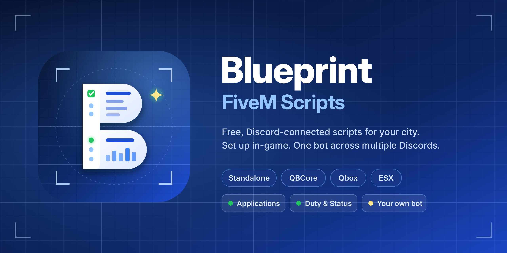

<p align="center">
  
</p>

<p align="center">
  <b>Free, Discord-connected FiveM scripts.</b><br>
  Set everything up in-game · One bot across multiple Discord servers · Use our bot or <b>your own</b>
</p>

<p align="center">
  
  
  
  
  
  <a href="https://discord.gg/GYb27Gvfrz"></a>
</p>

---

## 📦 What's inside

| Resource | What it does | Frameworks | Guide |
|---|---|---|---|
| **`bp_jobs`** | Job applications: interview peds, in-game questions, **Accept / Deny on Discord**, promotions, blacklist, offline hiring | Standalone · QBCore · Qbox · ESX | [README](bp_jobs/README.md) |
| **`bp_status`** *(demo)* | Live **server status panel** on Discord + **duty tracking** with shifts, logs and hours | QBCore (more coming) | [README](bp_status/README.md) |
| **`bp_discord`** | The Discord connection every Blueprint script uses. Runs its **own bot**, or connects to **your bot** | – | [README](bp_discord/README.md) |
| **`bot-bridge`** | Add-on for your own **discord.py** or **discord.js** bot (custom mode). *Not* a FiveM resource | – | [README](bot-bridge/README.md) |

## ✨ Highlights

**📝 Applications (`bp_jobs`)**
- An NPC ped for each job's desk, placed **in-game** with `/jobcenter`. Each ped posts to its own Discord channel.
- Every application shows the character name, CitizenID, FiveM name, **Discord**, **Steam**, phone, current job, and all the answers.
- **Questions are built in-game** per job: text, long text, numbers, or pick-from-a-list. You can start from templates (General, Police, EMS, Mechanic...).
- **Accept / Deny** buttons on Discord, with a reason form on Deny. Accepting works even when the player is **offline**.
- **Promotion requests** for people already in the job, plus a **job blacklist** (e.g. police can't apply elsewhere) and cooldowns.
- **Decision roles per job, set in-game**: the EMS staff decide in the EMS Discord, the police staff in the police Discord.
- Bosses manage their own job; admins manage everything. Everything is saved to SQL.

**🟢 Duty & Status (`bp_status`)**
- A **live panel** that edits itself: online/offline, players, uptime, and who's on duty per department. It has **Refresh** and **Connect** buttons.
- Every shift is tracked **per character** (switching characters never mixes hours), logged, and saved to SQL.
- **Department channels in-game** (`/dutysettings`): each department gets its own logs and its own panel, in its own Discord.
- Works with **any duty script** (MDT, clock-in ped, `/duty`...), because it reads the framework's on-duty state.
- `exports.bp_status:CountOnDuty('police')` for your heists and robberies.

**🤖 Use our bot or yours (`bp_discord`)**
- **Builtin**: the bot runs **inside your FiveM server**. No VPS, no extra hosting.
- **Custom**: add a small cog (discord.py) or module (discord.js) to **your existing bot**. FiveM connects to it over one port, secured with a shared secret, and your bot token never leaves your bot.
- **One bot, many Discords**: main city, police, EMS... point each job or panel at any channel.

## 🚀 Quick start

```cfg
# server.cfg
set bp_discord_token "YOUR_BOT_TOKEN"     # builtin mode (or see bot-bridge for your own bot)

ensure oxmysql
ensure ox_lib
ensure qb-core          # or qbx_core / es_extended / nothing (standalone)
ensure ox_target        # or qb-target, or textui
ensure bp_discord
ensure bp_jobs
ensure bp_status        # QBCore only for now
```

1. Download the latest release and drop `bp_discord`, `bp_jobs` and `bp_status` into `resources`.
2. Create the bot (2 minutes): see [bp_discord/README.md](bp_discord/README.md).
3. Start the server, join, and type **`/jobcenter`** and **`/dutysettings`**.

SQL tables are created automatically.

## 📋 Requirements

| Needed | For |
|---|---|
| [oxmysql](https://github.com/overextended/oxmysql) | all |
| [ox_lib](https://github.com/overextended/ox_lib) | all |
| [ox_target](https://github.com/overextended/ox_target) / qb-target (optional) | interview peds (or use textui) |
| FXServer artifacts with Node 22 (2025+) | `bp_discord` |
| QBCore · Qbox · ESX · or none | `bp_jobs` auto-detects. `bp_status` needs QBCore for now |

## 🗺️ Roadmap
- [x] Applications with Discord Accept / Deny
- [x] Live status panel + duty tracking
- [x] Use your own bot (discord.py / discord.js)
- [ ] `bp_status`: Standalone, Qbox and ESX support
- [ ] Weekly duty leaderboards and a boss view of employee hours
- [ ] **Discord boss menu**: hire, promote and fire from Discord (even offline), with job item removal

## 💬 Support
Questions, bugs or suggestions? Join the **[Blueprint Discord](https://discord.gg/GYb27Gvfrz)** and open a ticket.

Found a bug? Open an [issue](../../issues) with your framework, the console error, and the steps to reproduce it.

## 📄 License
Free to use on your server. See [LICENSE](LICENSE).

<p align="center"><sub>Made with 💙 by <b>Blueprint</b></sub></p>
